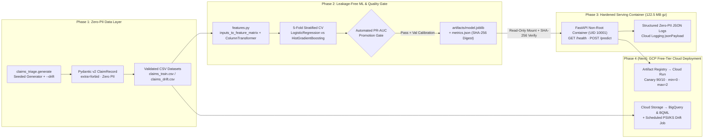

# Google Cloud End-to-End MLOps: Claims & Transaction QA Triage

End-to-end, cost-controlled Cloud ML and MLOps pipeline for **imbalanced claims/transaction exception detection and QA triage**, engineered to run on a **$0/month steady-state Google Cloud Always Free Tier** architecture (`us-central1`).

- **Live Portfolio & Engineering Logbook:** [https://vraidaten.com/logbook/](https://vraidaten.com/logbook/)
- **Author:** Satyajit Chakraborty (transitioning from 9.5 years in TCS financial services, UK pension, and US healthcare operations into Cloud Engineering, Cloud ML, and MLOps)

## End-to-End Architecture & Data Flow

## Architecture Highlights
- **Data & Zero-PII Contract:** Deterministic, seeded synthetic QA generator (`src/claims_triage/generate.py`) governed by strict Pydantic v2 `ClaimInput` / `ClaimRecord` schemas (`extra="forbid"`) with realistic ~2% base imbalance and `--drift` covariate shift.
- **Leakage-Free ML & Automated Quality Gate:** Python 3.13 (`uv`) + `scikit-learn` (`LogisticRegression` linear baseline vs. `HistGradientBoostingClassifier` candidate) wrapped inside a `ColumnTransformer` `Pipeline`, 60/20/20 stratified splitting, validation-only threshold calibration, PR-AUC promotion gate (`+0.157` CV PR-AUC lift, `0.889` holdout ROC-AUC), and SHA-256 artifact integrity verification (`artifacts/model.joblib` ~319 KiB).
- **Hardened Containerized Serving:** Multi-stage non-root `python:3.13-slim` Docker image (`uid=10001`, `122.5 MB` gzip-compressed) serving FastAPI `/health` and `/predict` with fail-closed `503` artifact checks and `~4.5 ms` warm inference latency.
- **DevSecOps & Supply-Chain Security:** Automated local (`make all`) and GitHub Actions (`DevSecOps Pipeline`) gates running `ruff`, `mypy --strict`, `bandit`, `pip-audit`, `detect-secrets`, `pytest` (`>=80%` floor, currently `98%+`), non-root container UID verification, and Trivy filesystem + container image scanning (`HIGH,CRITICAL`).
- **Planned Cloud Deployment (Phase 4):** Terraform IaC, keyless GitHub Actions CD via Workload Identity Federation (WIF), BigQuery ML baseline, Cloud Run 90/10 canary rollout (`min-instances=0`, `max-instances=2`), and scheduled PSI/KS drift detection.

## Serving API Reference (Phase 3)

| Endpoint | Method | Purpose | Guardrails & Status Codes |
| :--- | :--- | :--- | :--- |
| `/health` | `GET` | Cloud Run liveness/readiness probe verifying verified model load status, version, and 12-char SHA-256 prefix. | `200 OK` when verified artifact is loaded; fails closed with `503 Service Unavailable` (`status: "not_ready"`) if artifacts are missing or fail SHA-256 verification. |
| `/predict` | `POST` | Scores an 8-feature `ClaimInput` payload using the shared zero-skew feature pipeline and returns `exception_probability` plus `triage_bucket` (`AUTO_PROCESS`, `STANDARD_QA`, `PRIORITY_ESCALATION`). | `200 OK` JSON response + zero-PII JSON telemetry log; `422 Unprocessable Content` on out-of-range values, leaked `is_exception`, or unexpected PII fields (`extra="forbid"`); `503` if model is not loaded. |

## Local Quickstart (Phases 1–3)

Run the full local DevSecOps quality and security suite:
- `make all` — Runs `ruff`, `mypy --strict`, `bandit`, `pip-audit`, `detect-secrets`, and `pytest` (`>=80%` coverage gate).

Generate reproducible training and covariate-shifted evaluation datasets locally (output in `data/`, excluded from Git):
- `uv run --isolated python -m claims_triage.generate --n-samples 10000 --seed 42 --output data/claims_train.csv`
- `uv run --isolated python -m claims_triage.generate --n-samples 2000 --seed 99 --drift --output data/claims_drift.csv`

Run gated Phase 2 model training, threshold calibration, and SHA-256 artifact export locally (output in `artifacts/`, excluded from Git):
- `uv run --isolated python -m claims_triage.train --input data/claims_train.csv --output-dir artifacts --seed 42`

Build and run the hardened non-root Phase 3 Docker container locally with read-only mounted verified artifacts:
- `docker build -t claims-triage:local .`
- `docker run --rm -p 8080:8080 -v "$(pwd)/artifacts:/app/artifacts:ro" claims-triage:local`

## Engineering Documentation Index (`docs/`)

- **Core Specifications (6):**
  - [`docs/requirements.md`](docs/requirements.md) — Functional, statistical, FinOps, and security specifications.
  - [`docs/architecture.md`](docs/architecture.md) — End-to-end topology, service boundaries, and IAM least-privilege map.
  - [`docs/security-and-threat-model.md`](docs/security-and-threat-model.md) — Threat model, keyless auth, PII ban, and supply-chain controls.
  - [`docs/data-governance.md`](docs/data-governance.md) — Synthetic data design, zero-PII guarantees, class imbalance, and drift injection.
  - [`docs/runbook-and-finops.md`](docs/runbook-and-finops.md) — Budget alerts, operational triage, and `terraform destroy` teardown runbook.
  - [`docs/known-limitations.md`](docs/known-limitations.md) — Explicit engineering tradeoffs and scope boundaries.
- **Architectural Decision Records (`docs/decisions/` — 5 ADRs):**
  - [`001-use-case-synthetic-data-and-finops-architecture.md`](docs/decisions/001-use-case-synthetic-data-and-finops-architecture.md)
  - [`002-multi-repo-documentation-mirror-and-devsecops-gates.md`](docs/decisions/002-multi-repo-documentation-mirror-and-devsecops-gates.md)
  - [`003-deterministic-synthetic-generator-and-schema-contract.md`](docs/decisions/003-deterministic-synthetic-generator-and-schema-contract.md)
  - [`004-leakage-free-pipeline-pr-auc-gate-and-artifact-integrity.md`](docs/decisions/004-leakage-free-pipeline-pr-auc-gate-and-artifact-integrity.md)
  - [`005-fastapi-verified-serving-and-nonroot-multistage-docker.md`](docs/decisions/005-fastapi-verified-serving-and-nonroot-multistage-docker.md)
- **Operational Hurdles & Root-Cause Logs (`docs/hurdles/` — 3 Hurdles):**
  - [`001-revoked-trivy-action-tag-and-dependabot-pr-ordering.md`](docs/hurdles/001-revoked-trivy-action-tag-and-dependabot-pr-ordering.md)
  - [`002-column-transformer-object-dtype-and-ruff-skew.md`](docs/hurdles/002-column-transformer-object-dtype-and-ruff-skew.md)
  - [`003-symmetric-label-noise-and-pr-auc-collapse.md`](docs/hurdles/003-symmetric-label-noise-and-pr-auc-collapse.md)
